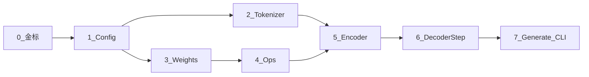

# Encoder–Decoder 推理实现规划（以 T5-small 打通）

## 目标与边界

**目标**：在 CPulse 中实现 Encoder–Decoder 推理路径，以 `t5-small` 为第一个可跑通模型。固定任务示例：

```text
translate English to German: How are you?
```

与 HuggingFace `T5ForConditionalGeneration` 在 `do_sample=False`（贪心）下前 N 个生成 token 对齐。

**先不做**：

- beam search
- GPU
- MoE / 其它 Enc–Dec 变体通用框架
- 与 Qwen decoder-only 共用同一套 `forward.c`

**与现有代码的关系**：

- Qwen 的 decoder-only 路径完整保留
- Enc–Dec 走独立模块；仅当 `cfg->arch == CP_ARCH_ENCODER_DECODER`（由 `arch_routes.json` 路由）时进入
- 路由配置仍由 `arch_routes.json` 维护；实现能力由代码打开

---

## T5 与当前引擎的关键差异

| 点 | Qwen（现有） | T5-small |
|----|--------------|----------|
| 配置字段 | `hidden_size` / `num_hidden_layers` / … | `d_model` / `d_ff` / `d_kv` / `num_layers` / `num_heads` |
| 位置编码 | RoPE | 相对位置偏置 `relative_attention_bias` |
| Norm | RMSNorm | LayerNorm（`layer_norm_epsilon`） |
| FFN | SwiGLU | DenseReluDense（`wi` / `wo`，ReLU） |
| 注意力 | 仅因果 Self-Attn | Enc 双向 Self；Dec 因果 Self + Cross（EncDecAttention） |
| 词表 | BPE（`vocab.json` + `merges.txt`） | Unigram（`tokenizer.json`） |
| 推理节奏 | 单塔 prefill + decode | 先 encode 全文，再 decode 逐步生成 |
| 权重前缀 | `model.layers.*` | `shared` / `encoder.block.*` / `decoder.block.*` |
| 权重 dtype | BF16 | 以实际 safetensors 为准（勿写死 BF16） |

`t5-small` 权重名示例：

- `shared.weight`
- `encoder.block.{i}.layer.0.SelfAttention.{q,k,v,o}.weight`
- `encoder.block.0.layer.0.SelfAttention.relative_attention_bias.weight`（通常仅 block 0）
- `decoder.block.{i}.layer.1.EncDecAttention.{q,k,v,o}.weight`
- `*.DenseReluDense.{wi,wo}.weight`
- `encoder.final_layer_norm.weight` / `decoder.final_layer_norm.weight`

---

## 推荐模块划分

不要把 T5 逻辑塞进现有 `forward.c` / `weights.c`。建议：

```text
src/t5/
  t5_config.c      # 解析 T5 config 字段
  t5_weights.c     # 按名字表绑定权重
  t5_tok.c         # SPM / tokenizer.json
  t5_ops.c         # LayerNorm、相对偏置、attn、FFN
  t5_encoder.c     # 整段 encode → memory
  t5_decoder.c     # 单步 decode + KV / cross cache
  t5_generate.c    # encode → 循环 decode
```

`command.c`：按策略分发——decoder-only 走现有 `cp_generate`；encoder-decoder 走 `t5_generate`。

---

## 分步实现

每一步都要有可重复验收；不破坏 Qwen 回归（无参加载仍 OK）。

### 步骤 0 — 定金标准备

- 用 HuggingFace 对 `t5-small` 固定输入跑贪心
- 记录：encoder 若干位置的 hidden；第 1～16 个生成 token id
- 约定 CLI 形态（例如 `--model .cache/t5-small --input "translate English to German: Hello"`）

**验收**：有一份可对照的 token 列表（及可选张量 dump）。

---

### 步骤 1 — Config 放行 Enc–Dec

- `model_type=t5` 时解析 T5 字段（`d_model`、`d_ff`、`d_kv`、`num_layers`、`num_heads`、`layer_norm_epsilon`、`decoder_start_token_id`、`eos_token_id`、`pad_token_id` 等）
- 可映射到独立 `cp_t5_config_t`，避免与 Qwen 的 `cp_config_t` 校验缠在一起
- `arch_routes.json` 仍将 `t5` 归入 `encoder-decoder`
- 打开 encoder-decoder 的实现开关，但只允许进入 T5 专用路径

**验收**：加载 t5-small 不再报 `strategy ... not implemented yet`，而是进入下一阶段（如权重未绑定）的明确错误。

---

### 步骤 2 — Tokenizer

使用通用的 `tokenizer.json`（Unigram + HF fast 词表），不再解析 `spiece.model`。

需要：`encode`、`decode`，以及 `pad` / `eos` / `decoder_start_token_id`。

**验收**：同一英文句子，token id 与 HF 完全一致。

---

### 步骤 3 — 权重绑定

按名字表绑定（t5-small 为单文件 `model.safetensors`）：

- `shared.weight`
- 每层 encoder：SelfAttention q/k/v/o、layer_norm、DenseReluDense；第 0 层 relative_attention_bias
- 每层 decoder：SelfAttention + EncDecAttention + FFN + norms
- `encoder/decoder.final_layer_norm`
- 相对偏置通常只在 block 0；后续层复用策略必须与 HF 一致
- dtype 按文件实际类型处理（F32 / BF16 / FP16）

**验收**：bind 报告 `n_bound/n_expected` 全绿。

---

### 步骤 4 — 基础算子

在 `t5_ops`（或扩展 `ops.c` 但命名隔离）实现：

1. LayerNorm
2. 相对位置 bias → attention logits
3. 双向 Self-Attention / 因果 Self-Attention
4. Cross-Attention（Q←decoder，K/V←encoder memory）
5. DenseReluDense：`wo(relu(wi(x)))`

**验收**：单层小矩阵与 NumPy/HF 对照，FP32 下误差约 `1e-4`～`1e-5`。

---

### 步骤 5 — Encoder 前向

- 输入：`src_ids[S]` → `shared` embedding
- 跑完 `num_layers` 个 encoder block
- 输出：`memory[S, d_model]`（常驻，供 cross-attn）

**验收**：固定输入下，与 HF encoder（final LN 后）若干位置余弦相似度接近 1 / 最大绝对误差可接受。

---

### 步骤 6 — Decoder 单步 + Cache

状态：

- Decoder Self-Attn 的 KV cache（随生成增长）
- Cross-Attn 的 K/V：可由 memory 按层预计算，生成过程中不变

单步：

```text
y_t = DecoderStep(token_{t-1}, pos, memory, caches) → logits[V]
```

首步输入 `decoder_start_token_id`（t5-small 为 0）。

**验收**：teacher-forcing 喂 HF 前缀 token 时，每步 argmax 与 HF 一致（先对齐再自由生成）。

---

### 步骤 7 — 生成会话与 CLI

流程：

```text
encode(src) → memory
tok = decoder_start_token_id
loop:
  logits = decode_step(tok)
  next = argmax(logits)
  emit / stop on eos / max_new
  tok = next
```

接入 `command`：encoder-decoder 模型的 `--input` 走 `t5_generate`；decoder-only 仍走现有路径。

**验收**：端到端输出可读译文/摘要；前 16 个 token 与 HF 贪心一致；Qwen 无参路径回归通过。

---

### 步骤 8 — 打磨与扩展（按需）

- 更长输入、多句、pad mask（batch=1 时可先忽略 pad）
- `t5-base` 等同结构放大验证
- GPU
- beam search（翻译常用，但不是第一刀）

---

## 依赖关系



- Tokenizer 与 Weights 可并行
- Encoder 依赖 Ops + Weights
- Decoder 依赖 Encoder
- 不要在 Decoder 未对齐前并行大拆 GPU

---

## 每步完成定义

1. 模块边界清晰（T5 与 Qwen 不互相污染）
2. 有一条可重复命令或小测试
3. 与金标对得上（token 或张量）
4. Qwen 回归：默认模型目录加载 / bind 仍 OK

---

## 工作量粗估

| 步骤 | 大约 |
|------|------|
| 0～1 | 1 天 |
| 2～3 | 2～4 天 |
| 4～6 | 5～8 天 |
| 7 | 1 天 |
| **合计打通 t5-small CPU** | **约 1.5～2.5 周**（视 SPM 与数值对齐难度） |

---

## 建议开工顺序

1. 步骤 0：HF 金标  
2. 步骤 1：T5 config 放行  
3. 其后严格按 2 → 3 → 4 → 5 → 6 → 7  

说「开工」时默认从步骤 0 + 步骤 1 开始改代码。
