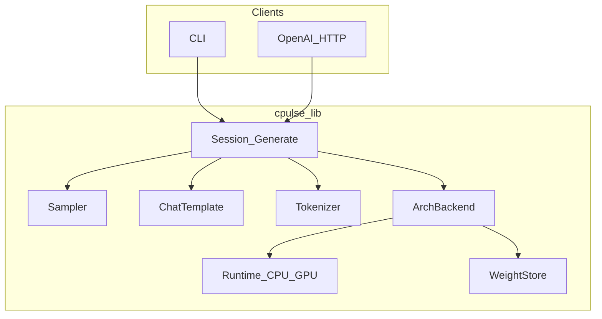
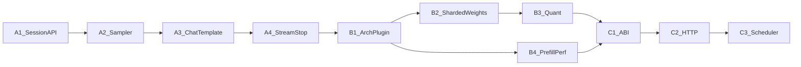

# CPulse 完整推理引擎落地计划

## 目标架构（三阶段共用）

- `Session`：一次生成的生命周期（prefill / decode / stop / stream callback）
- `ArchBackend`：按 `model_type` 选择层结构与权重布局（Qwen2 先落地，B 阶段加 LLaMA/Mistral）
- `Runtime`：算子后端（CPU 必选，CUDA 可选）
- C 阶段 HTTP 只调用库，不直接碰 forward

---

## Phase A — 教学完备单机引擎

**成功标准**：同一套 Qwen2.5-0.5B，CLI 能对话式生成；支持采样；token 流式打印；库边界从 `main` 里抽出来。

### A1. 抽出生成会话 API

- 把 [`src/main.c`](../src/main.c) 里 prefill + argmax 循环抽成 `cp_generate` / `cp_session_*`
- 建议新文件：`include/generate.h`、`src/generate.c`
- `main` 只负责参数解析与 IO；前向仍走现有 [`cp_forward_step`](../include/forward.h)

### A2. 采样器（替换纯 argmax）

- 新模块：`include/sample.h`、`src/sample.c`
- 能力：`temperature`、`top_k`、`top_p`、可选 `seed`；`temperature=0` 退化为现有 argmax
- logits → softmax → 截断/重归一 → 多项式采样
- CLI：`--temp` / `--top-k` / `--top-p` / `--seed`

### A3. Chat template（Instruct 对话）

- 支持 Qwen2 chat 模板（从 `tokenizer_config.json` / `chat_template` 解析或先硬编码官方模板）
- CLI：`--chat`；消息拼成 prompt 再 encode
- 保留现有 base 续写路径（无模板）

### A4. 流式输出与停止条件

- 每生成一个 token 回调 / 立即 decode 打印
- 统一 stop：`eos`、`<|im_end|>`、`--max-new`、可选 stop 字符串

### A5. A 阶段验收

- 对照现有贪心路径：`temp=0` 与旧行为一致
- 手工：`--chat` 多轮、流式可见；CPU/GPU 均可跑

**A 不做**：量化、多架构、HTTP、continuous batching。

---

## Phase B — 实用单机（多架构 + 性能）

**成功标准**：本机能跑 Qwen2 / LLaMA / Mistral 中至少各一档 instruct；7B 级靠量化可进显存；prefill 明显快于「逐 token matvec」。

### B1. 架构后端抽象

- 将 [`src/forward.c`](../src/forward.c) / [`src/weights.c`](../src/weights.c) 中 Qwen2 特有假设（q/k/v bias、RoPE 变体、norm 命名、SwiGLU 布局）收进 `cp_arch_qwen2`
- 新增 `cp_arch_llama`、`cp_arch_mistral`（无 bias、可能不同 RoPE/norm 命名）
- [`cp_config_t`](../include/model.h) 扩展：arch 枚举、可选字段（bias 有无、rope_scaling 等）
- 权重绑定按 arch 的名字表匹配，而不是写死 Qwen 路径

### B2. 权重存储增强

- 多分片 safetensors（`model-00001-of-000xx.safetensors` + index）
- 统一 `WeightStore`：按需映射 / 上传 GPU
- dtype：BF16/FP16 加载路径理顺

### B3. 量化（先 INT8，后 INT4）

- 权重 INT8（或 Q4_0/Q4_K 一类）离线转换工具 + 运行时 dequant-GEMV
- CPU 与 GPU 各一条路径；CPU 作数值对照
- CLI：`--quantize` 转换；推理自动识别量化权重目录

### B4. Prefill / Decode 性能

- Prefill：序列 matmul（一次多 token），替代逐 token `cp_matvec`
- Decode：保持 KV cache；GPU 侧减少每步 host↔device 拷贝（已有常驻权重可再收紧）
- 可选：简单算子融合（rmsnorm+matvec 边界清晰即可，不做过度融合）

### B5. B 阶段验收

- 每新增 arch：与 HuggingFace / 参考实现同 prompt 下 `temp=0` 前 N token 对齐
- 量化：困惑度或 token 一致率在可接受阈值内
- 记录 0.5B / 7B 的 tokens/s（prefill vs decode）

**B 不做**：多租户调度、HTTP 协议细节。

---

## Phase C — 服务引擎

**成功标准**：进程内链库可生成；同进程或旁路进程提供 OpenAI 兼容 HTTP；多请求可排队跑，至少支持静态 batch 或简易 continuous batching。

### C1. 稳定 C ABI 库

- 对外头文件收敛：`cpulse.h`（load / session / generate / stream / free）
- `main` 与未来 server 都只依赖该 ABI
- 明确线程约定：单 session 不线程安全；多 session 可并行（每 session 自有 KV）

### C2. 薄 HTTP 服务

- 独立 target：`cpulse-server`
- 实现 OpenAI 兼容子集：`POST /v1/chat/completions`（stream SSE）、`GET /v1/models`
- 内部只调库 API；模板与采样参数从 JSON 映射到 `cp_sample_params`

### C3. 请求调度

- 第一版：**FIFO 队列 + 单模型单 worker**（正确、简单）
- 第二版：decode 步级 **continuous batching**（共享权重、独立 KV、按 step 组 batch）
- 指标：队列长度、TTFT、tokens/s、拒绝/超时

### C4. C 阶段验收

- curl / 官方 SDK 能打通 chat.completions
- 并发 N 请求不串 KV；取消/超时不泄漏
- 与 CLI 同模型同参数时输出分布一致（`temp=0` 对齐）

---

## 阶段依赖与顺序

## 任务清单（按顺序勾）

### Phase A

- [x] A1: 抽出 `cp_session` / `cp_generate`，瘦身 `main`
- [ ] A2: 实现 temperature / top_k / top_p 采样器与 CLI 参数
- [ ] A3: Qwen2 chat template + `--chat`
- [ ] A4: 流式回调与统一 stop；A 阶段验收

### Phase B

- [ ] B1: ArchBackend 抽象，接入 LLaMA / Mistral
- [ ] B2–B3: 分片权重 + INT8/INT4 量化路径
- [ ] B4: Prefill 批量 matmul 与 GPU 常驻优化验收

### Phase C

- [ ] C1–C2: 稳定 C ABI + OpenAI 兼容 HTTP 子集
- [ ] C3: FIFO 调度后演进 continuous batching 与指标

## 建议落地节奏

1. **只先执行 Phase A**
2. A 验收通过后再开 B1（架构抽象是 B/C 的枢纽，不要提前大拆）
3. C 的 HTTP 与调度严格等库 ABI 稳定后再做，避免服务层倒逼内核

## 明确不做（全阶段）

- 训练 / 微调
- 非 CUDA 的其他 GPU 后端（除非 B 以后另开）
- 完整多模态
- 过度文档；需要时只维护根目录 README 的用法与阶段说明
